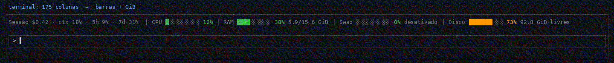

# sysmon-band

Mod do Claude Code que desenha **uma faixa acima do prompt** com o consumo da sessão e o uso da máquina, sempre em uma linha:

```
21/10/2026 14:07 │ Sessão opus-5-5 · ctx 47% · 5h 9% ↻ 2h14m · 7d 31% │ CPU ███████░░░ 93% │ RAM ██████░░░░ 66% 10.3/15.6 GiB │ Swap ░░░░░░░░░░ 0% desativado │ Disco ██████░░░░ 73% 92.8 GiB livres
```



> O GIF é uma ilustração renderizada com a mesma lógica de cores e de redução de largura do mod, não uma gravação da tela do Claude Code.

## O que mostra

| Item | Origem |
| --- | --- |
| Data e hora corrente (DD/MM/AAAA HH:MM) | `date`, no fuso local da máquina |
| Modelo da sessão (sem o prefixo `claude-`) | modelo em uso, como o `/model` mostra |
| Contexto (`ctx`), limites de 5h e 7d | uso da sessão no Claude Code |
| Tempo até a janela de 5h reiniciar (`↻ 2h14m`, horas e minutos) | horário de reinício informado pelo Claude Code |
| CPU | `/proc/stat`, variação entre duas leituras |
| RAM e Swap | `/proc/meminfo` (RAM usada = total − disponível) |
| Disco | `df` da partição `/`: percentual usado e espaço livre em GiB |

Atualiza a cada 2 segundos. Cores: verde abaixo de 60%, laranja de 60% a 84%, vermelho a partir de 85%.

**Terminal estreito:** se a linha completa não cabe, as barras somem e ficam só os números coloridos; se ainda não cabe, some também o texto de GiB e "desativado", ficando só os percentuais.

## Requisitos

- Claude Code com suporte a mods (hooks module com `ui.render`).
- Linux (CPU, RAM e Swap vêm de `/proc` e o disco de `df`). Em outros sistemas a parte de custo e limites funciona, mas CPU, RAM, Swap e Disco ficam vazios.

## Como ativar

### Instalar a partir do GitHub

No prompt de uma sessão do Claude Code:

```
/plugin install sysmon-band --marketplace jonatascraveiro/mod-system-monitor
```

Responda `y` para adicionar o marketplace e escolha o escopo (`user` vale para todas as sessões). O mod fica ativo na hora, sem reiniciar, e nas próximas sessões automaticamente.

Pelo shell:

```
claude plugin install sysmon-band --marketplace jonatascraveiro/mod-system-monitor
```

Se o repositório for privado, só instala quem tem acesso a ele no GitHub e uma credencial git para github.com na máquina (chave SSH, ou `gh auth login` seguido de `gh auth setup-git`).

### Rodar direto da pasta (para testar ou editar)

```
git clone https://github.com/jonatascraveiro/mod-system-monitor.git
claude --plugin-dir ./mod-system-monitor/mods/sysmon-band
```

Com `--plugin-dir` o mod recarrega sozinho quando os arquivos mudam.

## Desativar

```
/plugin disable sysmon-band
```

ou `claude plugin uninstall sysmon-band`.

## Estrutura

```
.claude-plugin/plugin.json        manifesto do mod
hooks/register.tsx                sessão, timer de 2 s e desenho da faixa
hooks/metrics.ts                  leitura de hora/CPU/RAM/Swap, cores e barras
hooks/metrics.test.ts             testes das métricas
hooks/register.test.tsx           testes da faixa (convivência com outros mods)
types/index.d.ts                  contrato do estado do mod
```

## Desenvolvimento

Na pasta `mods/sysmon-band`:

```
claude plugin validate .
claude plugin test .
```
